# VeloPopuli

*The people's indoor ride: open source, built by riders, for riders.* — **[velopopuli.com](https://velopopuli.com)**

<p align="center">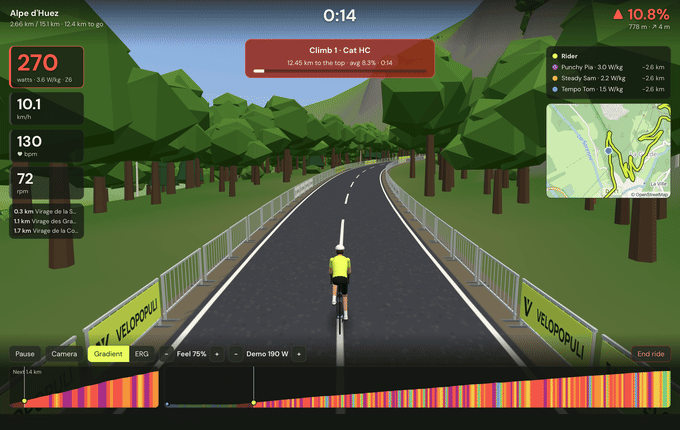</p>

Ride any GPX route on your indoor trainer. VeloPopuli turns a route file into a 3D world, drives your smart trainer's resistance from the real gradient, and makes a game of it with ghosts, pace riders, timed climbs, XP and badges.

Free and open source ([GPLv3](LICENSE)) for **Windows, macOS and Linux**. Written in **Rust**, with a thin web layer for drawing. Not affiliated with icTrainer or any other commercial product.

## What it does

- **GPX in, virtual ride out.** Import routes from Strava, Komoot, RideWithGPS or a bike computer. Routes with no elevation data (planner exports) get it filled in automatically.
- **A 3D version of the real place.** The road follows your GPX; the surrounding landscape is built from open elevation data, so the mountains on the horizon are the real ones. OpenStreetMap supplies the rest: the towns and villages you pass through, forests where the real forests are, lakes, rivers and streams, the side roads, lanes, footpaths and railways around you, and the bridges and tunnels of the real road — you ride over the river on a bridge deck, into the hillside through a lit tunnel, and under the motorway or railway that crosses overhead. A live OpenStreetMap minimap and a gradient-coloured elevation profile sit alongside. Works offline with generated hills.
- **Laps.** On a closed route, ride it once, for 2, 3, 5, 10 or 20 laps, or until you stop. The HUD counts the laps and the distance ridden, and the profile, landmarks and riders carry on across the line.
- **A closed road, race-day style.** The road you ride is set apart from the map's road network: steel crowd barriers line both sides (with banners on some, each section standing on its feet and leaning with the road on hills, and orange netting round the outside of tight hairpins instead), its surface is the real one — tarmac, concrete slabs, cobbles, gravel or dirt — and so is its width: a 7 m main road, a 5 m village street, a 3 m farm track. Both come from OpenStreetMap's tags for the roads along the route (`surface`, `width`, `lanes`, and the road class), or are guessed from the road class when those can't be fetched. Where the route leaves the mapped roads for 100 m or more — across a field, along an unmapped trail — it becomes a dirt track. Widths change gradually, and buildings, signs, other riders and the barriers all follow them. Ride the Arenberg trench on its setts and the Strade Bianche on white gravel — and feel them: rougher surfaces roll heavier, so you slow down on screen and the trainer gets harder.
- **Mountain-bike trails.** Where the route follows an unpaved path, a bridleway, a walking trail or a trail graded for mountain bikes (OpenStreetMap's `mtb:scale`, S0–S6, or estimated from the hiking grade), you ride a narrow earth singletrack with no barriers, the HUD shows the grade, and the harder the grade the heavier it rolls — on screen and on the trainer.
- **Find a route in the app.** Search for a place, click waypoints on the map and get a route along bike-friendly roads with real elevation (BRouter), or pick one of eight famous climbs (Alpe d'Huez, Mont Ventoux, Stelvio, Galibier, Tourmalet, Mortirolo, Zoncolan, Box Hill). Mountain bikers can plan along trails, or pick from the **waymarked MTB routes** mapped in the area on screen.
- **Smart trainer control.** Gradient simulation or ERG mode, over Bluetooth FTMS, Tacx FE-C-over-Bluetooth, or ANT+ FE-C. The gradient "feel" scales the real slope, softens descents and caps the steepest pitch (so a 15% ramp is rideable on any trainer). Shift your bike's own gears as normal, or set up **virtual gears** — your own chainrings and cassette or a preset — and shift with keys, a Bluetooth remote, a handlebar controller or on-screen buttons.
- **Structured workouts on any route.** Import Zwift `.zwo`, `.erg` or `.mrc` files, or use the built-in sessions (endurance, sweet spot, threshold, VO₂max, over-unders, sprints and an FTP ramp test). The trainer holds each target in ERG while the route scrolls by; adjust the intensity or skip a step mid-ride.
- **Fitness tracking.** Power curve (5 s to 1 h), an FTP estimate you can apply in one click, power zones on the HUD, and a training-load chart of fitness, fatigue and form.
- **Sensors.** Power meters, heart-rate straps, speed and cadence sensors over Bluetooth and ANT+. When several devices report the same metric the most direct one wins (crank power meter over trainer estimate, strap over relayed HR). Basic trainers with only a speed sensor can use estimated power.
- **Handlebar controllers.** Buttons that speak [OpenBikeControl](https://openbikecontrol.org), an open protocol, shift virtual gears, change the ERG target or workout intensity, skip a workout step, pause and switch camera without letting go of the bars. See [Handlebar controllers](#handlebar-controllers-openbikecontrol).
- **Gamification.** Race the ghost of your best time on each route, chase pace riders at fixed W/kg, and get timed on every auto-detected climb (categorised 4 → HC) and on the Strava segments along the route, with a live "ahead of / behind your best" gap. Race other people's rides as ghosts (GPX, FIT or from your Strava). A season goal (1,000 km by spring by default), week and day streaks, XP, levels and 23 badges.
- **Group rides.** Ride a route together with friends: share a room code, everyone's rider appears in everyone's world. Goes through a tiny relay server anyone can run (`crates/relay`).
- **Living world.** Village and town signs, summit boards named after the place at the top, and roadside cafés, fountains, bike shops and viewpoints from OpenStreetMap. Dawn, day, evening, dusk or night (with a lamp on the bike), and clear, cloudy, rain, fog or snow — or the weather at the real place right now. Optional street-level photos of the road from Mapillary (bring your own free token).
- **Fan and lights.** A fan that speeds up with your speed, power or heart rate, and a light coloured by power zone, through Home Assistant, a Shelly or Tasmota plug, or any webhook.
- **Recording and sharing.** Every ride is saved as a standard `.FIT` file (GPS, power, heart rate, cadence, laps, normalised power) and can be uploaded to Strava as a Virtual Ride in one click or automatically. Set a second folder under **Settings → Ride files** (iCloud Drive or Dropbox, say) and each ride is copied there too.
- **Demo rider.** A simulated rider and trainer so you can try everything with no hardware.

### On the road

| | |
|---|---|
| 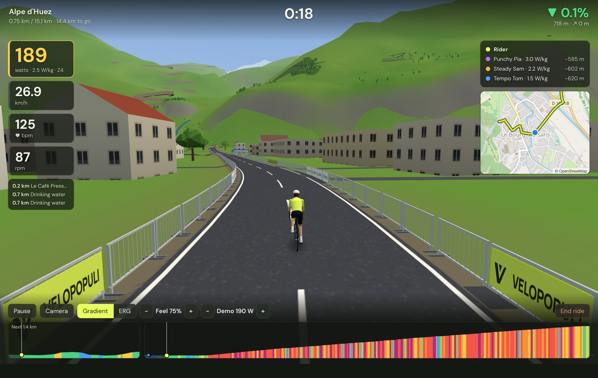 | 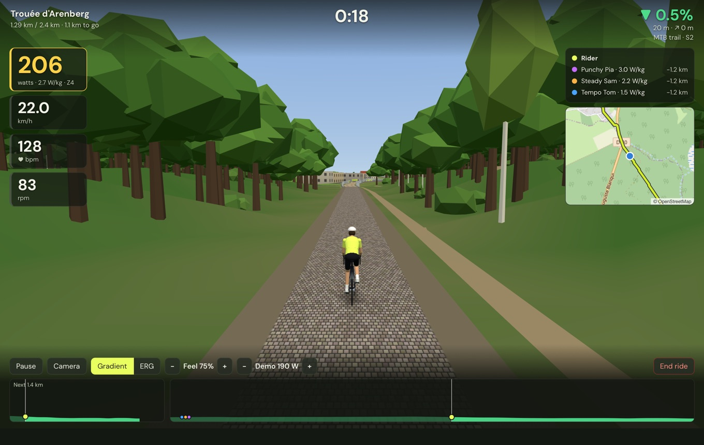 |
| **A closed road through the real town** — buildings, side roads and landmarks from OpenStreetMap | **The real surface and width** — the Arenberg trench on its setts, three metres wide |
| 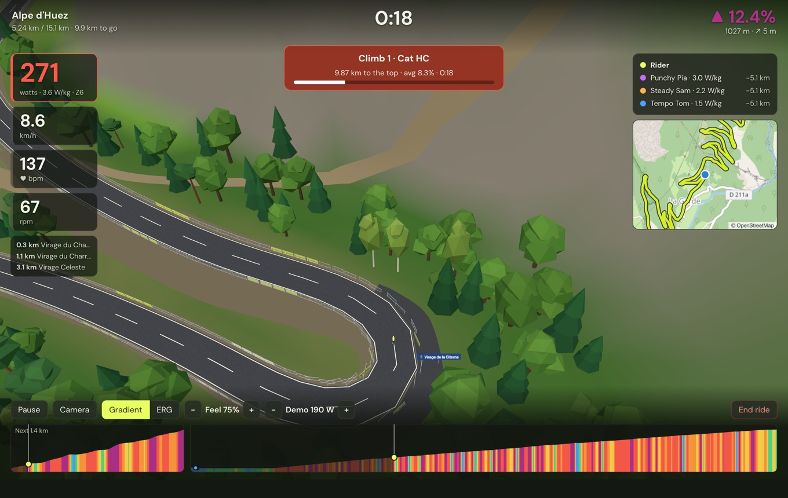 | 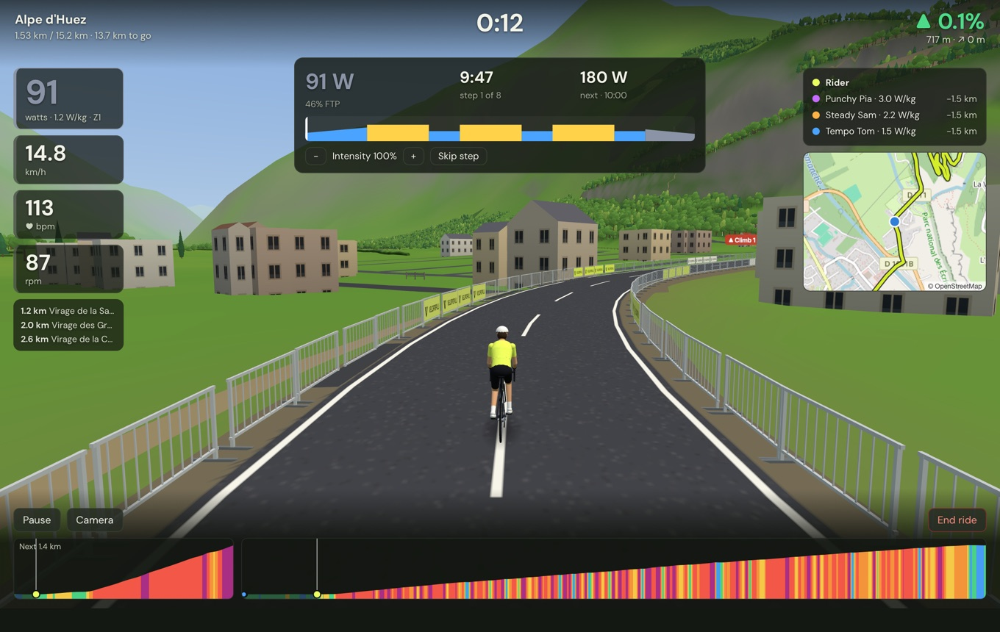 |
| **Real terrain** — the Alpe d'Huez switchbacks from the overhead camera | **Structured workouts** on any route, the trainer holding each target |
| 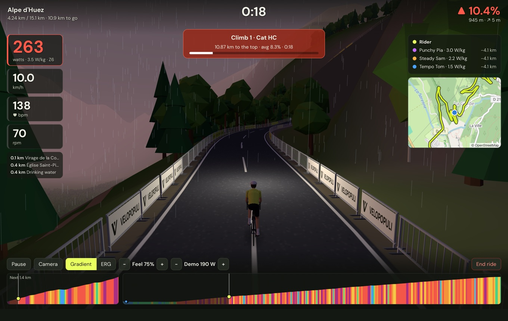 | 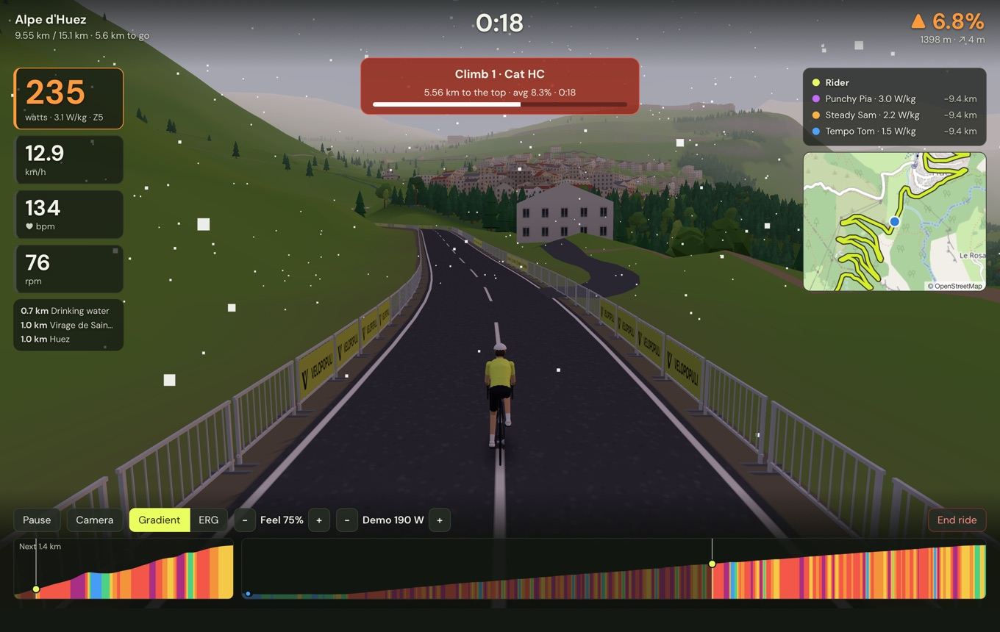 |
| **Time of day and weather** — dusk in the rain, with a lamp on the bike | …or dawn in the snow, or the live weather at the real place |
| 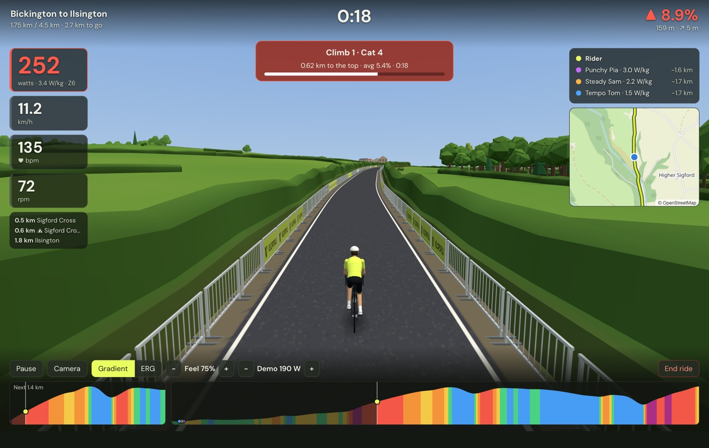 | 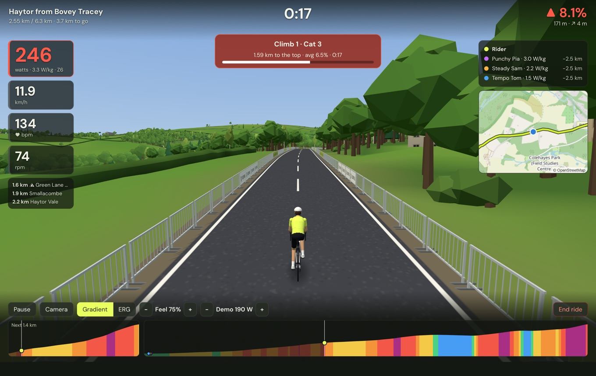 |
| **Holloways** — a Devon lane between hedge banks | **Field boundaries** — hedgerows, walls or fences in the style of the region, and the ones on the map |

### In the app

| | |
|---|---|
| 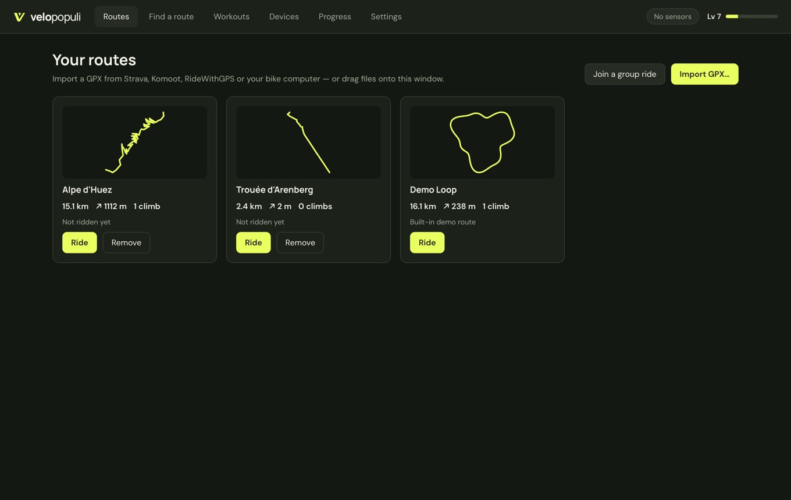 | 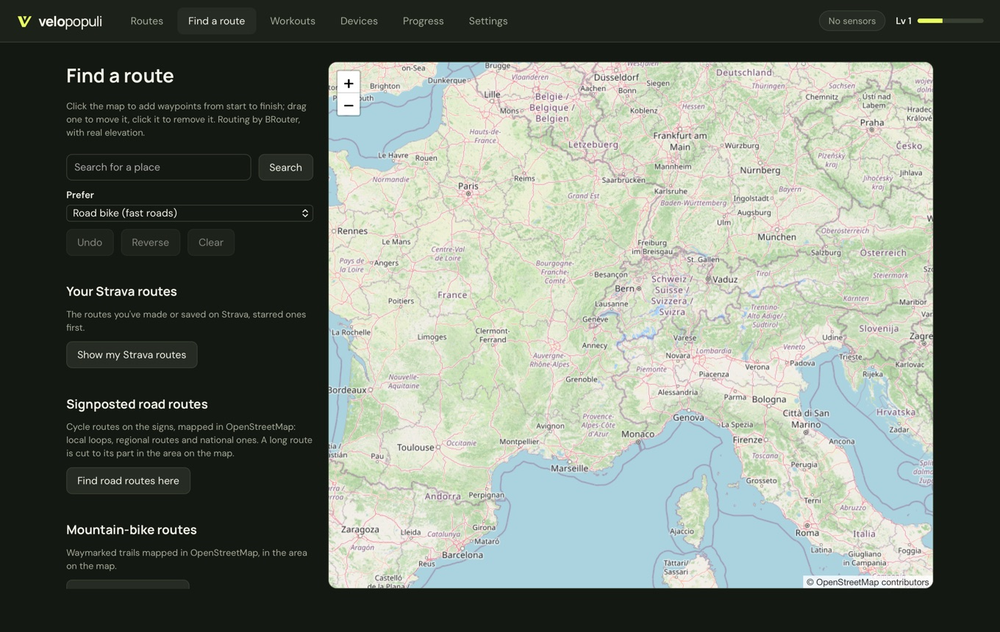 |
| **Your routes** — import GPX from anywhere | **Find a route** — plan one on the map or pick a famous climb |
| 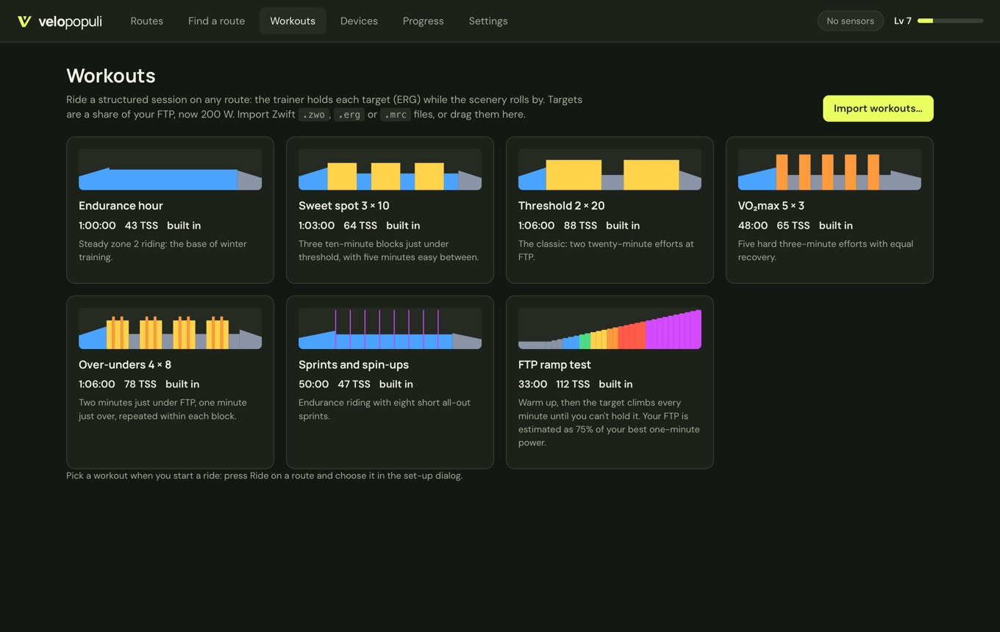 | 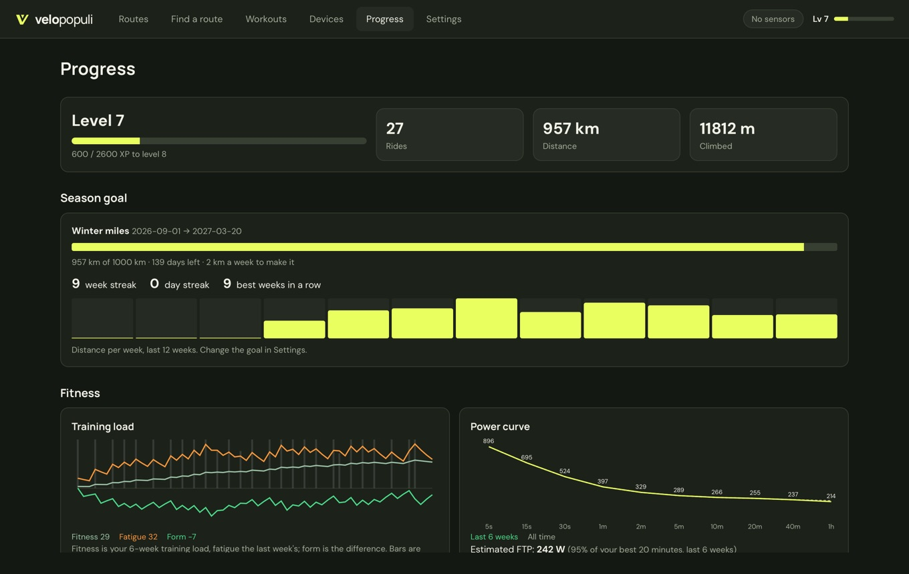 |
| **Workouts** — built-in sessions or your own .zwo/.erg/.mrc | **Progress** — season goal, streaks, training load and power curve (sample data shown) |

## How it is built

About three quarters of the code is Rust, and everything that computes or talks to hardware is in it: route building, physics, the ride simulation, workouts, the Bluetooth and ANT+ protocols and the 3D world's meshes are a library with no I/O and its own tests (`crates/core`); the app around it is Tauri 2 (`src-tauri`); the group-ride relay is a small server of its own (`crates/relay`). The full map of the code, and how a ride flows through it, is on the wiki's [Architecture](https://github.com/pepperstm/velopopuli/wiki/Architecture) page.

The web layer (`web/`, TypeScript, React, three.js) contains no ride logic: it receives state from Rust about 20 times a second, glides between updates, and draws. Terrain meshes are generated on Rust worker threads, so building landscape never stalls a frame. The window is the operating system's own webview (WebKit on macOS/Linux, WebView2 on Windows) rather than a bundled browser, which keeps the app to about 17 MB.

## Project status

Be aware of what has and has not been proven:

| Area | Status |
| --- | --- |
| GPX parsing, route building, climb detection, physics, ride recording, gamification, terrain, building and scenery generation, workouts, fitness maths, segment and ghost matching, landmarks, photo selection | Unit-tested (`cargo test`, 107 core tests) |
| Laps on loop routes | Unit-tested in `crates/core`: lap counting, distance ridden, climbs and segments timed on every lap, bests kept from the fastest lap, ghosts off. **Not yet** run in the app: no smoke run or screenshots of the lap HUD or of lap rides in either renderer. FIT lap messages and ending the ride on the workout are not done |
| Group-ride relay | Tested in-process (`cargo test -p velopopuli-relay`) and with two app instances riding together through a local relay |
| Fan and lights | Requests checked against a pretend device for Home Assistant, Shelly and a webhook; not tried with real plugs |
| Route finder, famous climbs | All eight climbs planned through the live BRouter service and checked against their known length and height gain |
| Waymarked MTB routes | Listed and joined from the live Overpass API around Finale Ligure (a 23 km route joined with no gaps); the joining is unit-tested. The screen itself was only type-checked, not clicked through |
| Strava segments and ghosts from Strava | Matching is unit-tested; the Strava calls have **not** been made against the live API |
| Street-level photos | Selection unit-tested and a bad token is reported correctly; not tried with a real Mapillary token |
| Native renderer | Screenshots from the automated run match the built-in renderer (day, dusk with rain fog, high camera, the leaning barriers and tree sprites of 0.3.6, and the hedge banks of 0.3.7). The HUD on top of it was not checked in a screenshot of the real window |
| FIT export | Unit-tested by decoding the output with an independent FIT parser |
| Bluetooth and ANT+ **protocol** encoding/decoding (FTMS, Cycling Power, CSC, HR, ANT framing, ANT+ HR/power/speed/cadence/FE-C pages) | Unit-tested against hand-built packets |
| OpenBikeControl controllers | Button messages, the one-action-per-press choice and the App Information message unit-tested against bytes from the protocol's reference encoder; **not yet tried with a real controller** |
| Full app: import → real-terrain download → ride → save FIT → personal best → summary | Verified by automated runs with the demo rider on macOS (Apple Silicon), in debug, dev-server and release builds |
| OpenStreetMap buildings | Verified against the live services on two Alpine routes and one across a city (about 5,900 buildings), through both data sources. Very long routes have not been tried. |
| The surrounding road network | Verified against the live map tiles on the same three routes, from screenshots of the automated run: city streets, footways and tram lines, village junctions, forest tracks, and a suburb full of roundabouts and divided roads. Frame rate with a whole city's streets in view has not been measured (about 1.3 million extra vertices in the centre of Grenoble). |
| Forests, water, bridges, tunnels, overpasses | Verified against the live map tiles on the same three routes: a valley town with a river, a reservoir road with a 1 km tunnel, and a city crossed by motorway and railway viaducts. Checked from screenshots of the automated run, not from a long ride. |
| Bluetooth and ANT+ with **real hardware** | **Testing has begun.** The first real trainer (a Tacx Vortex Smart over Bluetooth) connected but dropped out and showed no power; a diagnostics log and report were added to track it down. Expect to find bugs; please send a report (see *Reporting problems*) with your device model. |
| Strava connect and upload | **Not yet tested against the live API** (needs a personal API key). |
| Windows and Linux | **Built** (installers: `.msi`/`.exe`, `.deb`/`.AppImage`) by GitHub Actions on every push, which also runs the tests on Linux. **Not yet run** on either. |

## Installing on a Mac

Download `VeloPopuli_<version>_universal.dmg` from the [latest release](https://github.com/pepperstm/velopopuli/releases) (or build it with `npm run build:mac`), open it and drag **VeloPopuli** into **Applications**. It runs on Apple Silicon and Intel Macs with macOS 10.15 or later.

The app isn't notarised by Apple (that needs a paid developer account), so the first time you open it macOS will refuse. Either:

- open **System Settings → Privacy & Security**, scroll down to *"VeloPopuli" was blocked* and click **Open Anyway**, or
- run `xattr -dr com.apple.quarantine /Applications/VeloPopuli.app` once in Terminal.

On first connecting to a sensor macOS asks to let VeloPopuli use Bluetooth — allow it.

## Getting started

You need [Rust](https://rustup.rs) (stable) and [Node.js](https://nodejs.org) 20+.

- **Linux** also needs the WebKitGTK and device libraries: `sudo apt install libwebkit2gtk-4.1-dev build-essential libssl-dev libayatana-appindicator3-dev librsvg2-dev libdbus-1-dev libudev-dev pkg-config`
- **Windows** needs the MSVC build tools; WebView2 ships with Windows 10/11.

```bash
npm install
npm run dev        # run with hot reload
npm test           # Rust unit tests
npm run build      # optimised app + installer for this platform (target/release/bundle/)
npm run build:mac  # macOS: one installer for Apple Silicon and Intel (target/universal-apple-darwin/release/bundle/dmg/)
```

Then: **Routes → Import GPX…**, **Devices → connect your trainer**, and press **Ride**. No hardware handy? Press Ride on the built-in Demo Loop and choose **Use demo rider** (↑/↓ change its effort).

Ride keys: `Space` pause · `C` camera (behind, high behind, alongside, overhead) · `↑`/`↓` ERG target, workout intensity or demo rider effort. With virtual gears, the shift keys are yours to choose under **Settings → Gears**. A [handlebar controller](#handlebar-controllers-openbikecontrol) does all of this from the bars.

Group rides: run `cargo run --release -p velopopuli-relay` on a machine everyone can reach (port 47800), put its address (`ws://host:47800`) in Settings → Group rides, tick *Ride with friends* when starting, and give the room code to the others (Routes → *Join a group ride*).

To inspect a recorded ride: `cargo run -p velopopuli-core --example fitinfo -- path/to/ride.fit`.

## Connecting hardware

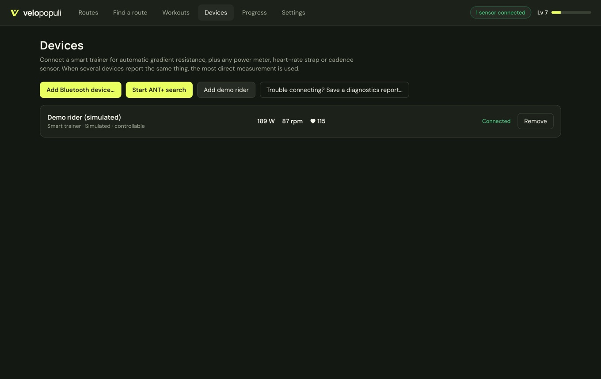

### Bluetooth

**Devices → Add Bluetooth device…** finds nearby trainers, sensors and controllers. Supported: FTMS smart trainers (Wahoo, Elite, Saris, Zwift, JetBlack and most others made since ~2018), Tacx trainers using FE-C over Bluetooth, Cycling Power meters, heart-rate monitors, speed/cadence sensors, and [OpenBikeControl](https://openbikecontrol.org) handlebar controllers.

To pair a device:

1. **Wake it**: spin the pedals or the cranks, put the heart-rate strap on, press a button on a controller.
2. **Free it**: close any other app or head unit using it (Zwift, the maker's app, a bike computer). Most Bluetooth devices talk to one app at a time.
3. Press **Devices → Add Bluetooth device…**. Devices appear by name as they are heard; click one to connect.
4. It joins the list with its kind (*Smart trainer*, *Power meter*, *Heart rate*, *Cadence*, *Speed* or *Controller*) and *Connected*, with its live readings. A trainer says *controllable* when VeloPopuli can set its resistance, or *read-only* when it can only read it.
5. Add the others the same way. When two devices measure the same thing, the most direct one is used.

If a device drops out (it goes to sleep, the trainer is switched off) it shows *Signal lost — searching…* and reconnects by itself when it's back. **Remove** disconnects it. Devices aren't remembered between launches yet, so add them again after opening the app.

- **macOS:** the first search asks for Bluetooth permission.
- **Linux:** needs BlueZ running.
- Not supported: older Wahoo KICKRs that only speak Wahoo's proprietary protocol (use ANT+ FE-C for those).

### Handlebar controllers (OpenBikeControl)

[OpenBikeControl](https://openbikecontrol.org) is an open protocol for handlebar buttons. A controller that speaks it over Bluetooth (the Stages SB200 has it built in) works in VeloPopuli:

1. To shift with it, choose **Settings → Gears → Virtual gears**. With *My bike's gears* the shift buttons do nothing; the other buttons still work.
2. Pair it like any device: wake it, close other apps using it, then **Devices → Add Bluetooth device…** and pick it. It shows as *Controller*.
3. Start a ride. The buttons only act during a ride.

| Button | What it does |
|---|---|
| Shift up / down | Harder / easier virtual gear |
| Increase / decrease difficulty | ERG target ±10 W, or the workout ±5% |
| Skip interval | Next workout step |
| Pause / Resume | Pause or resume the ride |
| Camera view | Next camera |

A controller often sends several of these for one button, so that every app finds one it knows. VeloPopuli does one thing per press: it shifts if it can, but in ERG (or a workout held in ERG) the difficulty buttons come first, as gears change nothing there. Holding a button counts as one press. A trainer or sensor with OpenBikeControl buttons of its own keeps its kind, and its buttons work too. Only the Bluetooth side of OpenBikeControl is supported, not its network mode.

### ANT+

Plug in an ANT+ USB stick (Garmin/Dynastream ANTUSB2 or ANTUSB-m) and press **Devices → Start ANT+ search**. VeloPopuli listens for one device of each kind — trainer (FE-C), power meter, heart rate, speed, cadence, speed+cadence — and adds each as it is heard.

The stick is driven directly through libusb, with no vendor SDK:

- **Windows:** the stick must use the generic **WinUSB** driver. Install it once with [Zadig](https://zadig.akeo.ie) (select the ANT stick → WinUSB → Replace Driver). Note this stops Garmin Express using the stick until you switch the driver back.
- **Linux:** allow non-root access: `sudo cp resources/99-ant-usb.rules /etc/udev/rules.d/ && sudo udevadm control --reload`, then replug. (The `.deb` package installs this rule for you.)
- **macOS:** no setup, but quit Garmin Express — only one program can hold the stick.

Current limits: one ANT+ device per type (the first one heard), and no pairing to a specific device number yet.

## Strava

Strava issues API keys per application, and a secret can't be shipped inside an open-source app, so each user creates a free personal key once:

1. Go to <https://www.strava.com/settings/api> and create an application (any name/website).
2. Set **Authorization Callback Domain** to `localhost`.
3. In VeloPopuli → **Settings → Strava**, paste the Client ID and Client Secret and press **Connect**.

Your browser opens for approval. The key and tokens are stored in the system keychain on macOS and Windows; on Linux they are kept in a file in the app's data folder readable only by your user. Rides upload as Virtual Rides with the route map.

## Notes on the model

- **Speed is simulated from power**, not read from the trainer: `P = (m·g·(sinθ + Crr·cosθ) + ½·ρ·CdA·v²)·v`, with air density falling with altitude. `Crr` is your tyres' rolling resistance on tarmac, multiplied for rougher surfaces (concrete ×1.25, gravel ×2.5, cobbles and earth ×3.5); the trainer feels the extra as added gradient. Trainer difficulty changes only what the trainer feels like, never your virtual speed.
- **Terrain** near the road is pinned to the route's own elevation so the road never floats or tunnels: the road stands on a level shelf, with a cutting up to the hillside on the uphill side (steep enough to show as rock) and an embankment down to it on the downhill side, each up to 7 m high. Any bigger difference — usually the terrain data being coarse — is blended away into real elevation data further out. Where hairpin arms sit almost on top of each other, the ground takes the lower arm's level and the upper arm stands on a retaining wall.
- **Buildings** come from OpenStreetMap. The first time you ride a route, the outlines within about 350 m of the road are downloaded and kept on your computer (refreshed twice a year). The detailed source (the Overpass API) includes mapped heights and storey counts but runs on overloaded volunteer servers, so if none answers within a few seconds the app uses OpenStreetMap's vector tiles instead — outlines only, with heights estimated from footprint size — and tries the detailed source again a fortnight later. Simple rectangular houses get pitched roofs; everything else is a flat-roofed block. Anything mapped on top of the road itself is left out. Fetching buildings or scenery sends the route's coordinates (or, for the tiles, which map squares it passes through) to those OpenStreetMap servers; each can be turned off under **Settings → Virtual world** if you prefer.
- **Forests, water, roads, bridges and tunnels** come from OpenStreetMap's vector tiles, for about a kilometre either side of the road, downloaded with the buildings and kept in the same way.
  - *Forests* are planted where they are mapped, about 300 trees a hectare; elsewhere there are trees in fields and hedges. Trees come in six kinds — spruce, pine, broadleaf, birch, cypress or poplar, and bushes — mixed by altitude and latitude (conifers towards the tree line and in the north, broadleaf woods in temperate lowlands, pines and cypresses in the south) and growing in stands. Trees further than about 200 m away are drawn as sprites (pictures of the same models, turned to face you), so distant woods stay as dense as near ones for a fraction of the drawing.
  - *Lakes and wide rivers* are sunk into the terrain and filled; rivers and streams mapped as lines are laid on the ground as ribbons. Water needs real terrain to lie in, so it is left out when riding on generated hills.
  - *Bridges and tunnels*: the route is compared with the mapped road network, and where it runs along a bridge or tunnel the road is treated as one — the ground drops away beneath a bridge deck (with piers under long ones), and a tunnel is bored through the hillside with a portal at each end. A recorded GPS track that strays more than about nine metres from the mapped road won't be matched, and that stretch is drawn as ordinary road on an embankment, as before.
  - On a route with no elevation of its own, the road is run evenly from one end of each bridge or tunnel to the other, rather than following the terrain down into the valley or over the hill. The approach to a tunnel mouth cut into a steep slope can still come out steeper than the real road, because the terrain data is coarse there.
  - *Overpasses and underpasses*: a road or railway bridge that crosses the route is drawn overhead with its approach embankments. Tunnels shorter than 50 m are drawn the same way, as a slab over an open road. The map doesn't say how high such a bridge is, so all are given the same headroom.
  - *Other roads*: every mapped road, track, footway and railway within roughly a kilometre (footpaths: a few hundred metres) is laid on the ground, cut to fit the terrain exactly, and the ground's small bumps are smoothed out under them. The map's separate pieces are joined into continuous roads — the one that goes straightest through a junction carries on — so bends are smooth, a roundabout is one ring, and the corners where roads meet are rounded off. Main roads get an edge line that runs round the outside of merges and junctions rather than across them, and a centre line unless they are one-way or a roundabout; tracks and paths are gravel; railways have rails. Roads that meet the one you are riding are cut to its edge: a side road opens a mouth in your edge line, and a road that forks off or runs alongside butts up against it. Their bridges are drawn as simple decks, and their tunnels are left out. Roads, tracks and railways are level across: on a hillside they are cut into the slope and carried on embankments (up to 4 m high), like the route; footpaths and driveways follow the ground as it is. The mapped copy of your own road is left out — recognised as the nearest mapped road that keeps within about 6 m of your track for 40 m or more — so a track that wanders further than that may show it running alongside.
  - *Field boundaries*: hedges, walls and fences mapped within about 120 m of the route are drawn where they are (asked for along with the road tags, so only when the Overpass API answers). Elsewhere, within about a kilometre, fields are made up in the style of the region: hedgerows, with the odd tree growing out of them, in Britain, Ireland and the bocage of north-west France; dry-stone walls on their hills and round the Mediterranean; timber fences on mountain pastures and in Scandinavia; a scattering of hedges and fences in the big open fields of the rest of Europe. They keep off roads, water, woods, cliffs and villages and clear of mapped boundaries, and stop at the tree line. The made-up fields don't match the real ones.
  - *Holloways*: in that hedge country, below about 260 m, narrow lanes run between high hedge banks: earth to about 1.2 m with a hedge on top, about 3 m in all. The route gets them where it is a lane (6 m wide or less), just behind its barriers, and so do the minor roads and tracks around it, with gaps where another road, a stream or a house meets the lane and now and then for a gateway. Hedges mapped right beside such a lane give way to its banks. The terrain is too coarse (10 m) to sink the lane itself, so the banks stand on the ground rather than the lane being cut down between them.
  - The camera follows the rider into tunnels, close behind, whichever view is selected.
- **Elevation is smoothed** (~60 m) before gradients are computed, so noisy GPS altitude doesn't make the trainer twitch. Routes with their own elevation data give better gradients than ones filled in from terrain data, which is coarse on steep hillsides.

## Roadmap

- Hardware testing across trainers and sensors; pairing to specific ANT+ devices; multiple devices per type
- Native renderer: Windows and Linux, and making it the default
- More from OpenStreetMap: mapped roof shapes, other land cover (farmland, rock, glaciers), mapped leaf types, squares and car parks
- Wahoo legacy protocol and steering; Di2 and Zwift Click/Play controllers as shifters for virtual gears without a bridge
- Remembering devices between launches

### Stretch: self-hosted group-ride servers

Group rides already go through a small relay anyone can run (`crates/relay`; CI builds it for every platform). The stretch goal is to make running your own server for a club or group of friends a first-class option:

- A Docker image and a one-line install, with secure connections (`wss://`) out of the box
- Private rooms with passwords, and a server list in the app so riders can switch between their club's server and others
- Persistent club features on the server: scheduled rides, shared routes and leaderboards
- Simple admin: who is connected, room limits, and kicking riders

## Reporting problems

Something not working with your trainer or sensors? After the ride, press **Report a problem…** on the ride summary (or **Devices → Trouble connecting?**, or **Settings → Diagnostics**), say what happened, and save the report. It is one text file covering the last couple of days: every connection and drop-out, the raw data each sensor sent, what was sent to the trainer, and a ride line every second, with a summary at the top (drop-outs per device, longest silence, seconds pedalled with no power reading). It contains no account details, tokens or locations. **Report on GitHub…** saves the file, opens this project's new-issue page with the summary filled in and shows the file, so you just drag it onto the page and press *Create*. Mention your trainer model and how it was connected (Bluetooth or ANT+). Issues are public, so only send what you're happy to share.

The logs themselves live in the app's data folder under `logs/` (**Settings → Diagnostics → Open logs folder**); the last 12 runs are kept.

## Documentation

Guides for riders and developers are in the [wiki](https://github.com/pepperstm/velopopuli/wiki) (also in [`docs/wiki/`](docs/wiki)).

**Want to help or take something on?** Start with [HANDOFF.md](HANDOFF.md): where the project stands, how it's built and tested, how releases work, what's next and why things are the way they are.

## Data and credits

- Map tiles, building and scenery data © [OpenStreetMap](https://www.openstreetmap.org/copyright) contributors (ODbL), via the OSM tile servers, the public [Overpass API](https://wiki.openstreetmap.org/wiki/Overpass_API) instances and [vector.openstreetmap.org](https://vector.openstreetmap.org). Heavy users should configure their own servers, per the OSM usage policies.
- Place search by [Nominatim](https://nominatim.org) and route planning by [BRouter](https://brouter.de) (both OpenStreetMap-based); waymarked mountain-bike routes from OpenStreetMap through the [Overpass API](https://overpass-api.de); weather from [Open-Meteo](https://open-meteo.com); street-level photos from [Mapillary](https://www.mapillary.com) (CC BY-SA).
- Typefaces [DM Sans](https://github.com/googlefonts/dm-fonts) and [Manrope](https://github.com/googlefonts/manrope), bundled under the SIL Open Font Licence (`web/src/fonts/`).
- Terrain from the [Terrain Tiles](https://registry.opendata.aws/terrain-tiles/) open dataset (Tilezen/Mapzen; sources include SRTM, USGS 3DEP, EU-DEM and others).
- ANT+ access uses the ANT+ managed network key, which is issued to ANT+ adopters. If you distribute builds, register as an adopter (free) at [thisisant.com](https://www.thisisant.com).

## License

Copyright © 2026 Graham Barber and VeloPopuli contributors.

VeloPopuli is free software under the **GNU General Public License, version 3 or later** — see [LICENSE](LICENSE).

In short: anyone may use, study, share and change it. Anyone who distributes it, changed or not, or distributes something built from it, must do so under the same licence and make the source code available — so VeloPopuli, and everything made from it, stays open source.

This applies to every version, including those first published under the MIT licence (up to and including 0.2.0): the copyright holder relicensed them under GPLv3 on 19 October 2026. Anyone who obtained one of those versions under MIT before then keeps the MIT rights to that copy.
