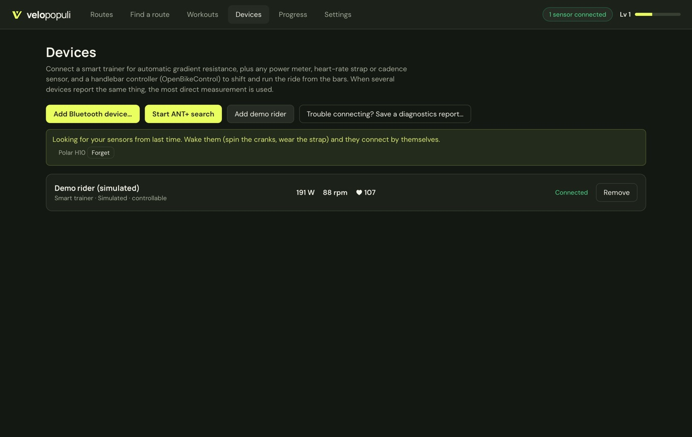

# Connecting your trainer

Open **Devices**. VeloPopuli talks to trainers and sensors directly — over your computer's Bluetooth, or over an ANT+ USB stick — with no manufacturer software in between.

## Before you start

- **One app at a time.** Most trainers and sensors accept a single Bluetooth connection. Close Zwift, the manufacturer's app, and anything on your phone or watch that might grab the trainer first. A trainer that keeps dropping out is very often being fought over.
- **Wake it up.** Spin the pedals so the trainer is awake and advertising.
- **Mains power.** Smart trainers that run from the mains (most wheel-on Tacx models, for example) need it plugged in to control resistance.

## Bluetooth

**Devices → Add Bluetooth device…** searches and lists what it hears; click one to connect.

Once connected, the device joins the list with its kind (*Smart trainer*, *Power meter*, *Heart rate*, *Cadence*, *Speed* or *Controller*), *Connected* and its live readings. A trainer says *controllable* when VeloPopuli can set its resistance, or *read-only* when it can only read it. Add each device the same way; when two measure the same thing, the most direct one is used.

If a device drops out (it sleeps, or the trainer is switched off) it shows *Signal lost — searching…* and reconnects by itself when it's back.

### Next time you open the app

You only pair a Bluetooth device once. Next time you open the app, it looks for your devices from last time for a few minutes, and connects each one as it wakes up: spin the cranks, or put the strap on. The Devices page shows which ones it's still looking for. The ANT+ stick is turned on again too, if you used it.

**Remove** disconnects a device and forgets it. **Forget** does the same for one the app is still looking for.

### What works over Bluetooth

| Device | What you get |
|---|---|
| Smart trainers made since about 2018 (Wahoo, Elite, Saris, Zwift, JetBlack and most others) | Gradient and ERG control |
| Tacx smart trainers (Neo, Flux, Vortex, Bushido, Genius…) | Gradient and ERG control, through Tacx's own connection if the trainer needs it |
| Power meters | Power, and cadence if it sends it |
| Heart-rate straps, and watches that broadcast heart rate | Heart rate |
| Speed and cadence sensors | Speed and cadence |
| Handlebar controllers (OpenBikeControl) | Shifting, ERG and workout controls: see [Virtual gears](Virtual-gears#controllers) |

Not supported yet: older Wahoo KICKRs that only use Wahoo's own connection. Connect those over ANT+ instead.

- **macOS** asks for Bluetooth permission on the first search.
- **Linux** needs Bluetooth (BlueZ) running. If a sensor shows up but won't connect, update to 0.3.10 or later, which pauses the search while it connects.

## ANT+

Plug in an ANT+ stick (Garmin/Dynastream ANTUSB2 or ANTUSB-m) and press **Devices → Start ANT+ search**. The first trainer (FE-C), power meter, heart-rate strap, speed, cadence and speed+cadence sensor heard are each added.

- **Windows:** the stick needs the generic **WinUSB** driver. Install it once with [Zadig](https://zadig.akeo.ie): select the ANT stick → WinUSB → Replace Driver. (Garmin Express can't use the stick until you switch back.)
- **Linux:** allow non-root access with `sudo cp resources/99-ant-usb.rules /etc/udev/rules.d/ && sudo udevadm control --reload`, then replug. The `.deb` does this for you.
- **macOS:** no setup; quit Garmin Express first.

For now ANT+ takes one device of each kind, the first it hears, and you can't pick a particular one.

## Several devices

When more than one device reports the same thing, the most direct measurement wins: a crank power meter over the trainer's estimate, a chest strap over heart rate relayed by the trainer. On a basic trainer with only a speed sensor, turn on **Settings → Trainer & physics → Estimate power from a speed sensor**. It works out your power from a typical fluid trainer, so treat it as a rough guide.

## It won't connect, or keeps dropping out

1. Close every other app that could be connected to the trainer (see above), then remove and re-add it under Devices.
2. Try the other connection: ANT+ if Bluetooth misbehaves, or the other way round.
3. Ride for a few minutes until it goes wrong, then press **Report a problem… → Report on GitHub…** on the ride summary. The report shows every connection, drop-out and message the trainer sent, which is usually enough to fix it. See [[Reporting problems]].

### Tested hardware

Real-world testing has only just begun. Please add your trainer to an issue (worked / didn't) so this list can grow:

| Trainer or sensor | Connection | Result |
|---|---|---|
| Tacx Vortex Smart (T2180) | Bluetooth | First test: dropped out and showed no power — being investigated with diagnostics |
