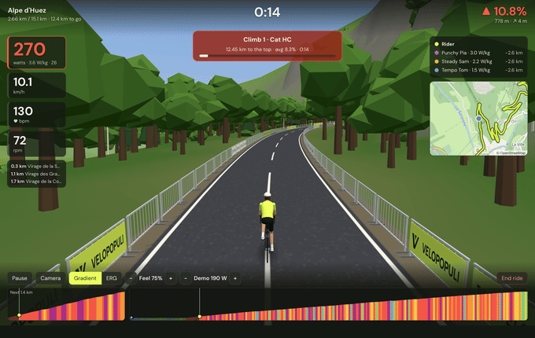

# VeloPopuli

*The people's indoor ride: open source, built by riders, for riders.* — [velopopuli.com](https://velopopuli.com)

VeloPopuli turns any GPX route into a 3D world built from OpenStreetMap and open elevation data, drives your smart trainer from the real gradient, and makes a game of it with ghosts, pace riders, timed climbs, workouts and a season goal. It's free, open source (GPLv3) and runs on Windows, macOS and Linux.

## Start here

- [[Installing]] — get the app onto your computer
- [[Connecting your trainer]] — Bluetooth and ANT+, and what to do when it won't connect
- [[Your first ride]] — import a route, pick a mode, ride

## Using the app

- [[Routes and the map]] — importing, planning and finding routes, Herne Hill Velodrome, and the world around you
- [[Riding]] — the screen and keys, gradient and ERG, laps, ghosts and pace riders, time of day and weather, ending a ride
- [[Workouts]] — built-in sessions, importing .zwo/.erg/.mrc
- [[Virtual gears]] — shift with keys or a remote instead of your bike's gears (optional)
- [[Progress and goals]] — power curve, FTP, training load, streaks, badges and the season goal
- [[Strava]] — upload rides, ride your Strava routes, race your rides as ghosts, segments
- [[Dreeve]] — upload rides to your own Dreeve server, and ride them again
- [[Group rides and self-hosting]] — ride together; run your own relay
- [[Fan and lights]] — Home Assistant, Shelly, Tasmota and webhooks

## Help

- [[FAQ]]
- [[Reporting problems]] — the diagnostics report and how to send it

## For developers

- [[Contributing]] — how to help
- [[Building from source]] — developing, testing and the automated checks
- [[Architecture]] — how the code is organised

> **VeloPopuli is young.** The 3D world, workouts and progress tracking are well tried, but only a few trainers and sensors have been used with it so far. If something doesn't work with yours, a [[diagnostics report|Reporting problems]] is the quickest way to get it fixed.
