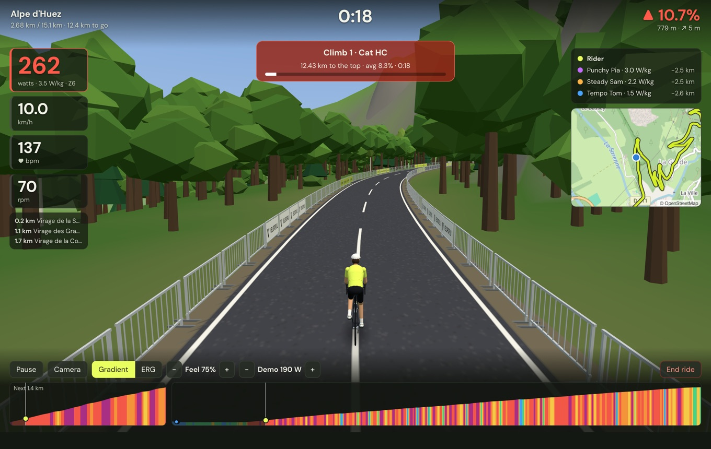
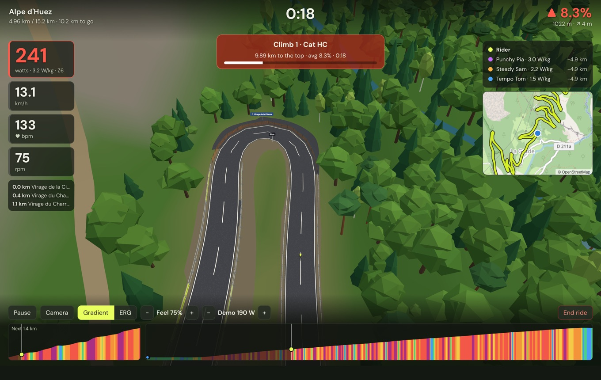
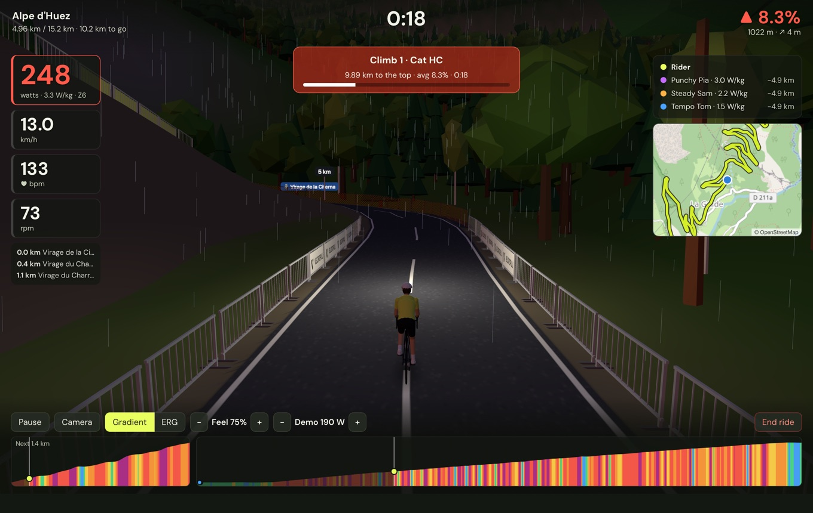
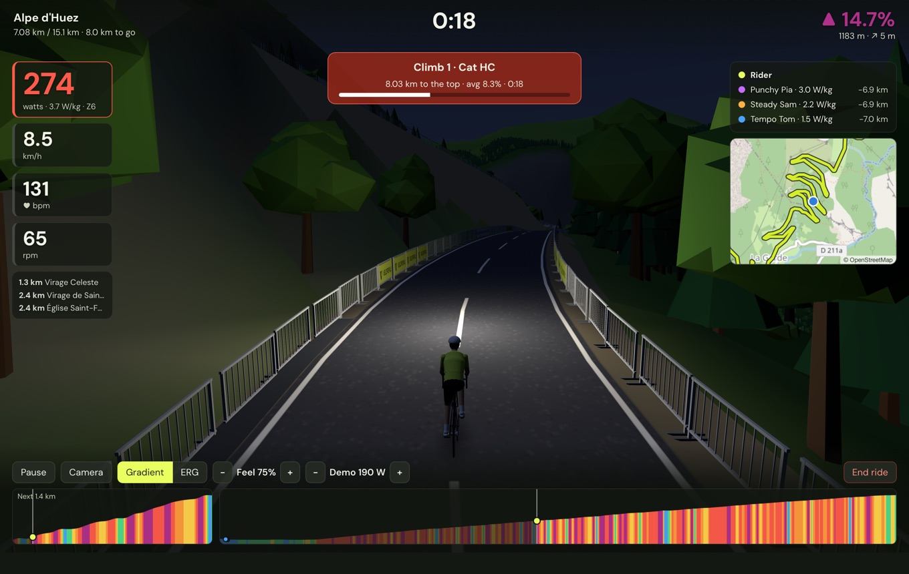

# Riding

## Setting up a ride

Press **Ride** on a route. Before you start you can choose:

- **Direction** (Herne Hill only): anticlockwise, as raced, or clockwise.
- **Laps**, on a route that ends where it starts (see [below](#laps)).
- **Workout:** ride a structured session on the route (see [[Workouts]]).
- **Ghosts to race:** your best ride on the route, and others you add (see [Racing](#racing)).
- **Segments:** with [[Strava]] connected, find the Strava segments along the route to be timed on.
- **Group ride:** ride with friends (see [[Group rides and self-hosting]]).

Then press **Start riding**.

## The screen

- **Left:** your power (with watts per kilo and your power zone), speed, heart rate and cadence. Below them, what's coming up: villages, summits, cafés.
- **Top:** the ride clock, and the gradient on the right.
- **Right:** the riders around you, and a map of where you are.
- **Bottom:** two height profiles: the next stretch, and the whole route.
- On a climb, a banner counts down to the top. On a Strava segment, it shows whether you're ahead of or behind your best.

### Keys

| Key | What it does |
|---|---|
| `Space` | Pause and resume |
| `C` | Change camera: behind, high behind, alongside, overhead |
| `↑` / `↓` | Raise or lower the ERG target, the workout's intensity, or the demo rider's effort |

The same controls are on screen, along the bottom. A [handlebar controller](Virtual-gears#controllers) can do them too.

## How hard it feels

- **Gradient mode** (the default): the trainer gets harder as the road climbs and eases off downhill. **Feel** scales it: 100% is the real gradient, 50% is half as steep. Under **Settings → Trainer & physics** you can also cap the steepest pitch and soften descents, so a 15% ramp is rideable on any trainer.
- **ERG mode:** the trainer holds a set power whatever the road does. Use `↑` and `↓` to change it.
- **Gears:** shift your bike's gears as you would on the road. If you'd rather shift with keys or buttons, see [[Virtual gears]].

Your speed comes from your power, your weight, the slope and the air, just as outdoors. The trainer's resistance changes how it feels, never how fast you go. That's why your speed can differ from what the trainer's own display says.

### The road surface

Cobbles, gravel and dirt are slower than tarmac. You slow down on screen, and the trainer gets harder to match. At the same power you might do 34 km/h on tarmac, 31 on gravel and 29 on cobbles.

Mountain-bike trails are slower again, and the harder the trail's grade, the slower it gets. On technical trails there's also a speed limit, as you'd brake there outdoors.

To set your tyres, or turn this off, go to **Settings → Trainer & physics → Feel the road surface**. It does nothing in ERG mode.

## Laps

On a route that ends where it starts, such as the Demo Loop or Herne Hill, the setup screen offers **Laps**: once round, 2, 3, 5, 10 or 20 laps, or until you stop.

- The screen shows which lap you're on and the distance so far, such as **Lap 3 of 10 · 24.10 km**.
- Climbs and segments are timed on every lap, and your fastest counts.
- Ghosts are off on a lap ride, and a lap ride doesn't set the route's best time. Your distance, goals and badges count every lap.

## Racing

- **Pace riders** hold a steady effort, in watts per kilo, for you to chase or drop. Set them under **Settings → Virtual world → Pace riders**.
- **Your ghost** is your best ride on the route. Beat it and your new ride becomes the ghost.
- **Other rides as ghosts:** add a GPX or FIT file, or pick one of your rides with **From Strava…** or **From Dreeve…**. Rides that follow the route are listed first.
- **Climbs** along the route are found and graded, from category 4 up to HC, and timed every time you ride them.

## Time of day and weather

Ride at dawn, in the day, in the evening, at dusk or at night (with a lamp on the bike), or follow the real clock. Pick clear, cloudy, rain, fog or snow, or use the live weather where the route is. Both are under **Settings → Virtual world**.

| | |
|---|---|
|  |  |

## Ending a ride

Finish the route, or press **End ride** at any time. The summary shows your distance, time, climbing, power and heart rate, and any personal bests, segment bests and badges you've earned. If the ride suggests a new FTP, you can set it in one click.

Every ride is saved as a `.FIT` file, which most training sites can import. **Show .FIT file** finds it on your computer. With [[Strava]] or [[Dreeve]] connected, upload the ride from the summary, or have it sent automatically.

Rides under a minute aren't saved. If you press **End ride** that early, the app asks whether you want to keep riding or leave without saving.

## Native renderer (macOS, experimental)

**Settings → Virtual world → Native renderer** draws the world straight on the Mac's graphics chip rather than through the app's web view. It can run more smoothly. It's new, so if something looks wrong, turn it off and [[report it|Reporting problems]].
