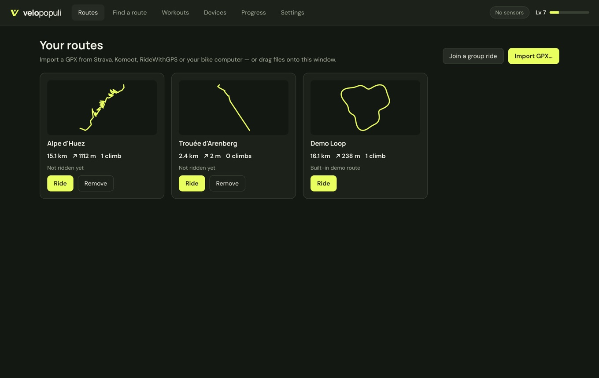
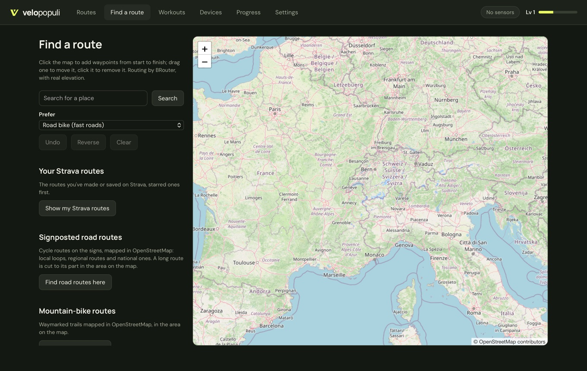
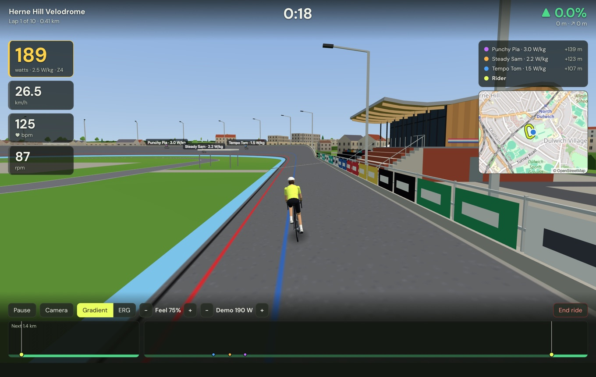
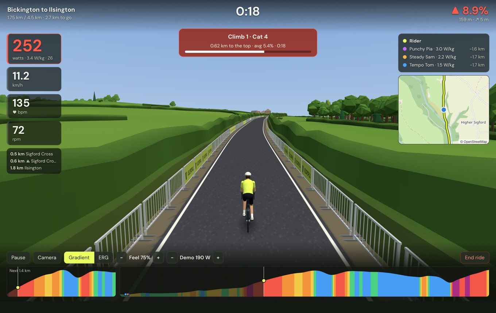
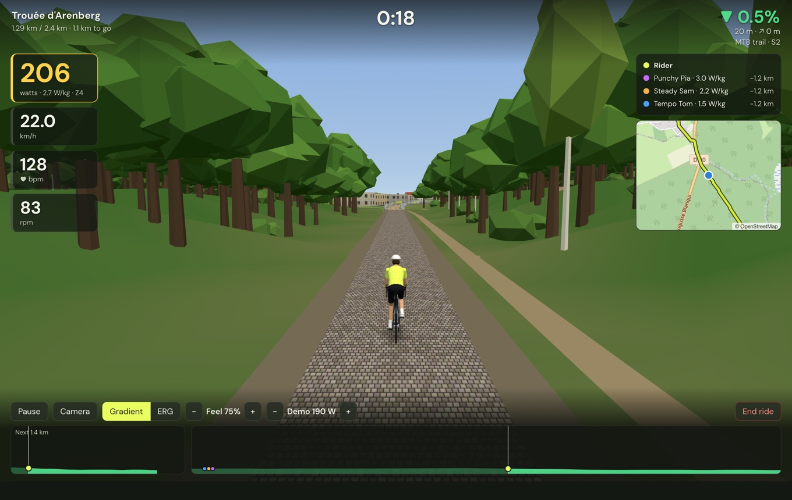

# Routes and the map

**Routes** is your library. Every route you add stays here, with its distance, climbing and your best time. Press **Ride** on a card to set up a ride, or **Remove** to delete it.

Two routes are always there: the **Demo Loop**, and **Herne Hill Velodrome** (see [below](#herne-hill-velodrome)).

## Adding a route

### Import a GPX file

Press **Import GPX…**, or drag files onto the window. Any GPX works: exports from Strava, Komoot, RideWithGPS, Garmin Connect or a bike computer. If the file has no heights (many planners leave them out), they're filled in for you.

### Plan one on the map

Open **Find a route**.

1. Search for a place, or move the map there.
2. Pick a **Style for new sections**:
   - **Road bike:** fast, direct roads.
   - **Quiet roads:** lanes and minor roads, away from traffic.
   - **Gravel:** gravel roads and good tracks where there are some.
   - **Touring:** a mix of quiet roads, cycle paths and good tracks.
   - **Safest:** cycle paths and the quietest roads, even if it's longer.
   - **Mountain bike:** trails and paths.
3. Click to add waypoints from start to finish. The route follows the roads between them, with real heights.
4. Change it:
   - **Drag the route** to pull in a new waypoint between two others.
   - **Drag a waypoint** to move it. **Click one** to remove it.
   - Under **Sections**, each stretch between two waypoints has its own style. So you can ride the lanes out, take a gravel track across, and come home on the main road.
5. Give it a name and press **Save to library**.

The buttons:

- **Undo** and **Redo** (also ⌘Z and ⇧⌘Z, or Ctrl+Z and Ctrl+Shift+Z).
- **Reverse** rides it the other way.
- **Close the loop** adds a way back from the finish to the start.
- **Out and back** rides back the way you came.
- **Clear** starts again.

### Make a loop

Under **Make a loop**, choose how far and which way to head off (or **Any way**), and press **Make a loop**. You get a round trip from your first waypoint, or from the middle of the map if you haven't added one, in the style for new sections. Don't like it? **Try another** gives a different one from the same place.

The loop comes as ordinary waypoints, so you can drag it, move them or change a section's style like any route.

### What the route is made of

Under the route's distance and climbing you'll find:

- **About how long it takes** at three quarters of your FTP, worked out with the same physics as your rides: your weight, your bike and the hills. With **Road surfaces** on in Settings, gravel and cobbles slow it down too.
- **The elevation profile**, with the climbs shaded, and a list of the climbs.
- **Surface:** how much is paved, cobbles, gravel or dirt, and how much isn't mapped.
- **Road type:** how much is on main roads, minor roads, cycle paths, tracks and paths.

Point at a surface or road type to show where it is on the map, or press **Surface** or **Road type** beside **On the map** to colour the whole route by it.

### Pick a ready-made route

Also on **Find a route**:

- **Your Strava routes.** With [[Strava]] connected, press **Show my Strava routes** to list the routes you've made or starred there, starred ones first. Pick one to see it on the map with its climbing and profile, then press **Save to library**. If you connected Strava before version 0.3.10, only your public routes are listed: connect again in Settings to see your private ones too.
- **Signposted road routes.** Move the map to an area and press **Find road routes here**. You get the signposted cycle routes there: local loops, regional routes and national ones. A long national route is cut down to the part on the map.
- **Mountain-bike routes.** **Find MTB routes here** does the same for waymarked mountain-bike trails. If a trail's pieces don't quite join up, you're told, and you ride straight across the gaps.
- **Famous climbs.** Alpe d'Huez, Mont Ventoux, the Stelvio, Galibier, Tourmalet, Mortirolo, Zoncolan and Box Hill, ready to ride.

The area searched can be up to about 60 km across: if the app asks you to zoom in a little, do that and search again.

### Ride one of your Dreeve rides again

With [[Dreeve]] connected, **Import from Dreeve…** on the Routes page lists the rides you've done. Search by name or date, or filter by bike and distance, then pick one to turn it into a route. It needs Dreeve 5.4 or later.

## Herne Hill Velodrome

The outdoor track in south London where the 1948 Olympic track races were held, built into the app. It's 450 m round, banked steeply into the bends, with the pavilion, the stands and the floodlights around it.

When you set up a ride there, choose the **Direction**: anticlockwise, as they race it, or clockwise. Pick a number of **Laps** too (see [[Riding#laps]]).

## The world around your route

The first time you ride a route, the app downloads the map and the landscape for it. That takes from a few seconds to a minute. After that it's kept on your computer, and the route starts straight away, even offline.

What you ride through is built from real map data:

- **The landscape** is the real one, out to the horizon, so the mountains you see are the ones that are there.
- **Towns and villages** have their buildings, and there are village signs, summit boards, cafés, fountains and bike shops by the road.
- **Woods, lakes, rivers, railways and other roads** are where the map puts them. You ride over bridges and through tunnels where the real road does.
- **Fields** have hedges, stone walls or fences, in the style of the region. In hedge country, such as Devon, narrow lanes run between high hedge banks.

### The road you ride

Your route is a closed road, lined with crowd barriers like a race. It has the real road's surface and width:

- **Surface:** tarmac, concrete, cobbles, gravel or dirt. You can feel it: rougher surfaces are slower and make the trainer harder (see [[Riding#the-road-surface]]).
- **Width:** a wide main road, a village street or a narrow lane, as it is on the map.
- **Off-road:** paths, bridleways and mountain-bike trails become narrow earth trails without barriers. The HUD shows a trail's difficulty grade, from S0 (easy) to S5 and up, where the map has one. Tight turns on graded trails are banked. Where a trail crosses a stream with no bridge, you ride through the ford.

If a road's surface or width is wrong, it's usually wrong on the map. See the [[FAQ]].

## Privacy and turning things off

To build the world, the app sends the route's position to the OpenStreetMap services. Nothing else is sent. If you'd rather keep things simple, or your computer is slow, you can turn buildings and scenery off under **Settings → Virtual world**.

Map data © OpenStreetMap contributors.
