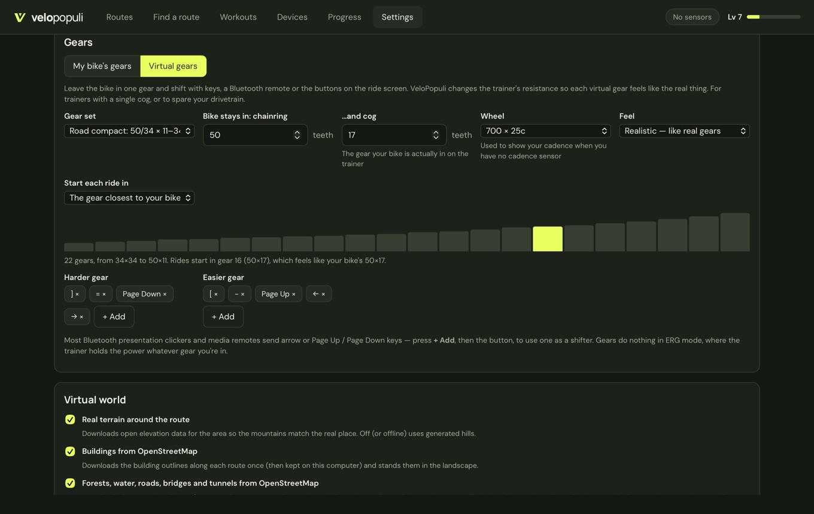
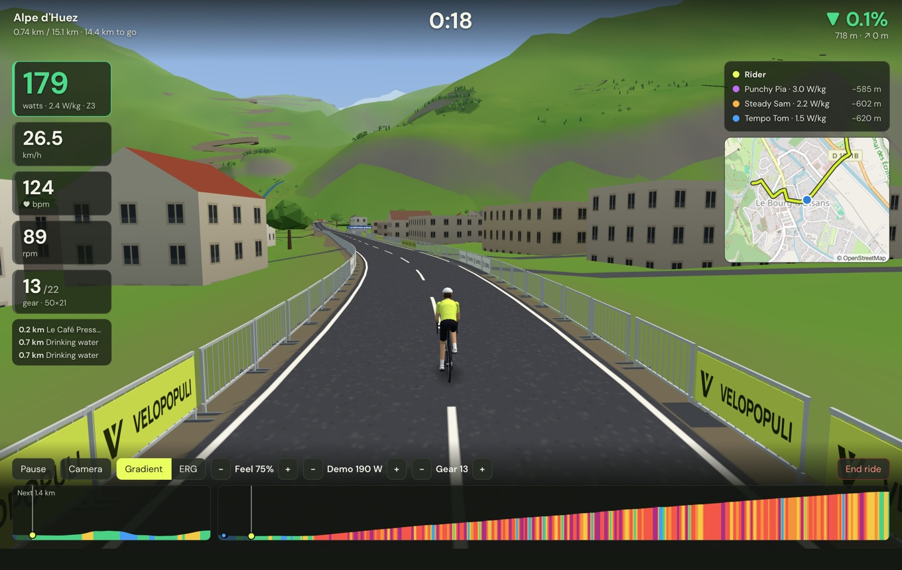

# Virtual gears

**Most riders don't need these.** If you shift your bike's own gears on the trainer, that already works exactly as on the road — the trainer feels how fast its flywheel turns — and there is nothing to set up. That's the default (*Settings → Gears → My bike's gears*).

**Virtual gears** are for leaving the bike in one gear and shifting with keys, a Bluetooth remote, a [handlebar controller](#controllers) or on-screen buttons instead: handy for trainers with a single cog, to spare your chain and cassette, or to shift without reaching down. VeloPopuli changes the trainer's resistance so each virtual gear feels like the real thing.

## Setting up

**Settings → Gears → Virtual gears**, then:

| Setting | What it means |
|---|---|
| **Gear set** | A preset (24 evenly spaced gears; road compact, semi-compact and standard doubles; gravel and mountain-bike 1×) or **My own chainrings and cassette** — type your teeth, e.g. `50, 34` and `11, 12, 13, 14, 15, 17, 19, 21, 24, 27, 30, 34`. On a double, every combination is put in order from easiest to hardest, with near-duplicates merged, so you step through the whole range one gear at a time. |
| **Bike stays in** | The real chainring and cog your bike is in on the trainer. This is what the virtual gears are measured against: in the virtual gear that matches it, the trainer behaves exactly as it would with no virtual gears at all. |
| **Wheel** | Only used to show your cadence when you have no cadence sensor (worked out from your speed and gear). |
| **Feel** | **Realistic** follows the physics of real gears. **Simple steps** adds a fixed amount of gradient per gear (you choose how much) — more predictable if your trainer behaves oddly with the realistic version. |
| **Start each ride in** | The gear closest to your bike's, or a gear you pick. |
| **Harder / Easier gear** | The keys that shift. Press **+ Add** and then any key — or a button on a Bluetooth presentation clicker or media remote, most of which send arrow or Page Up/Page Down keys. Defaults: `]` `=` Page Down → (harder) and `[` `-` Page Up ← (easier). |

The bars under the settings show every gear, from easiest to hardest, with the starting gear highlighted.

## Riding

The current gear shows on the HUD under cadence, and **− Gear +** buttons appear in the controls. The new resistance is sent the moment you shift. Gears do nothing in **ERG** mode, where the trainer holds the power whatever gear you're in, or in workouts that hold targets in ERG.

## Controllers

Controllers that speak [OpenBikeControl](https://openbikecontrol.org), an open protocol for handlebar buttons, work over Bluetooth. The Stages SB200 has it built in.

1. Choose **Virtual gears** above, so the shift buttons have gears to change. (With *My bike's gears* they do nothing; the other buttons still work.)
2. Wake the controller, close any other app using it, then **Devices → Add Bluetooth device…** and pick it. It shows as *Controller*.
3. Start a ride. The buttons act only during a ride, doing what the keys do:

| Button | What it does |
|---|---|
| Shift up / down | Harder / easier virtual gear (nothing with *My bike's gears*) |
| Increase / decrease difficulty | ERG target ±10 W, or the workout ±5% |
| Skip interval | Next workout step |
| Pause / Resume | Pause or resume the ride |
| Camera view | Next camera |

A controller can send several of these for one button, so that every app finds one it knows (shift up and increase difficulty, say). Each press does only one thing: shifting wins, except in ERG — or a workout held in ERG — where gears change nothing and the difficulty buttons win. Holding a button counts as one press. A trainer or sensor with OpenBikeControl buttons of its own keeps working as a trainer or sensor, and its buttons work too.

## How it works

Your speed always comes from your power, so gears don't make you faster. They change how that power feels: a harder gear means more force on each pedal stroke at a lower cadence, as on the road. VeloPopuli makes the trainer heavier or lighter to match the gear you're in, using the trainer's normal controls, so it works with every trainer the app supports.

A few things follow, just as outdoors:

- On the flat at low speed there's little resistance to change, so gears make little difference. They matter at speed and on climbs.
- On a descent steep enough to carry you, no gear gives you anything to push against.
- Very hard gears at low speed can ask for more resistance than a wheel-on trainer can give, and very easy ones on descents for less. The trainer does what it can.

## Coming later

Shimano Di2 hood buttons and Zwift Click/Play controllers as shifters without a bridge app, and the built-in virtual shifting of Zwift Hub-type trainers.
