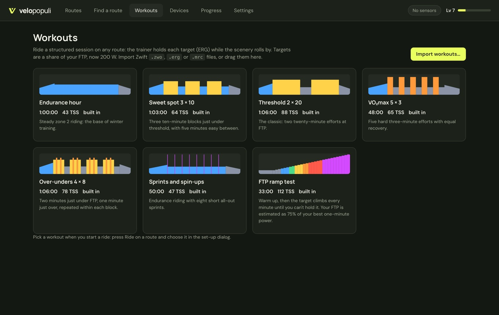
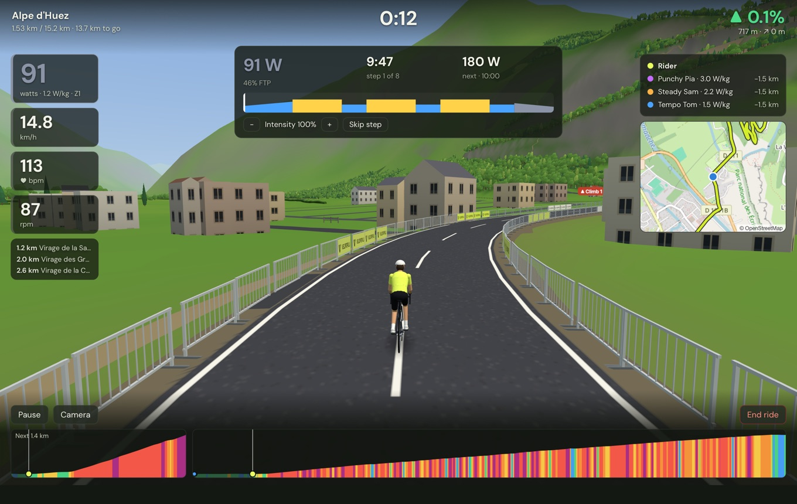

# Workouts

Ride a structured session on any route: the trainer holds each step's target in ERG while the scenery rolls by.

- **Built in:** endurance hour, sweet spot, threshold, VO₂max, over-unders, sprints, and an **FTP ramp test** (your FTP is estimated as 75% of your best one-minute power).
- **Import** Zwift `.zwo` files and `.erg`/`.mrc` files under **Workouts → Import workouts…** (or drag them on).
- Targets are a share of your FTP (Settings → Rider).
- During the ride: `↑`/`↓` adjust intensity, **Skip step** moves on. With **Settings → Trainer & physics → Hold workout targets** off, targets are shown and the gradient drives the resistance instead.
- Three beeps count down the last seconds of each step, and a higher tone marks the start of the next. Steps shorter than 8 seconds don't get a countdown. Turn the beeps off under **Settings → Sound → Workout countdown** (see [[Riding#sound]]).

