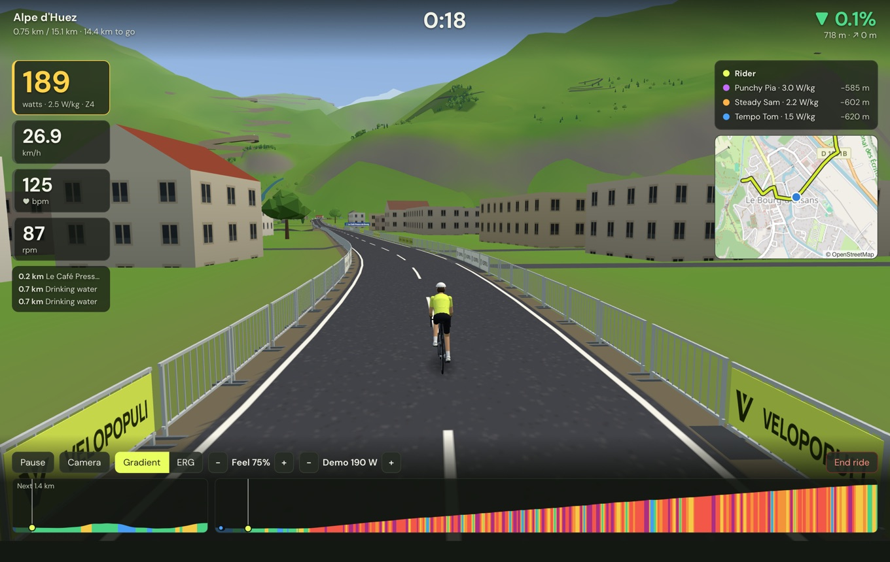

# Your first ride

1. **Get a route.** On **Routes**, press **Import GPX…**, or drag a file onto the window. Exports from Strava, Komoot, RideWithGPS or a bike computer all work. Or open **Find a route** to plan one, or pick a famous climb or a signposted route there. No route handy? The **Demo Loop** and **Herne Hill Velodrome** are always in your library.
2. **Connect your trainer** under **Devices** (see [[Connecting your trainer]]). No trainer? Press **Add demo rider** to try everything with a simulated one.
3. **Press Ride** on the route. You can add a workout, ghosts to race, laps or a group ride, or just press **Start riding**.
4. The first ride on a route downloads its map and landscape, which takes a few seconds to a minute. After that it starts straight away.

**During the ride:** `Space` pauses, `C` changes the camera, and `↑`/`↓` change the ERG target, the workout's intensity or the demo rider's effort. See [[Riding]] for the rest.

**After the ride:** finish the route or press **End ride**. The summary shows your time, power, personal bests and badges. The ride is saved as a `.FIT` file, and you can send it to [[Strava]] or [[Dreeve]] in one click. Rides under a minute aren't saved.

**Next time:** your trainer and sensors connect by themselves when you open the app. Just wake them up.
